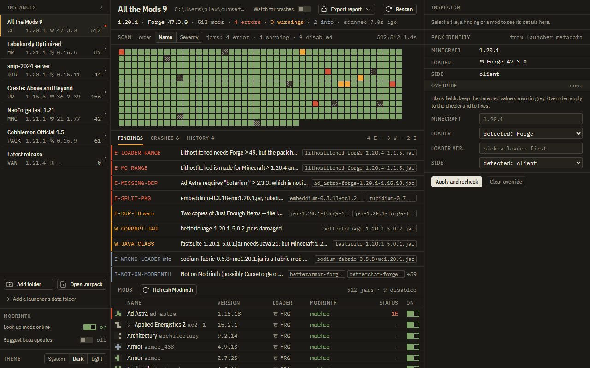
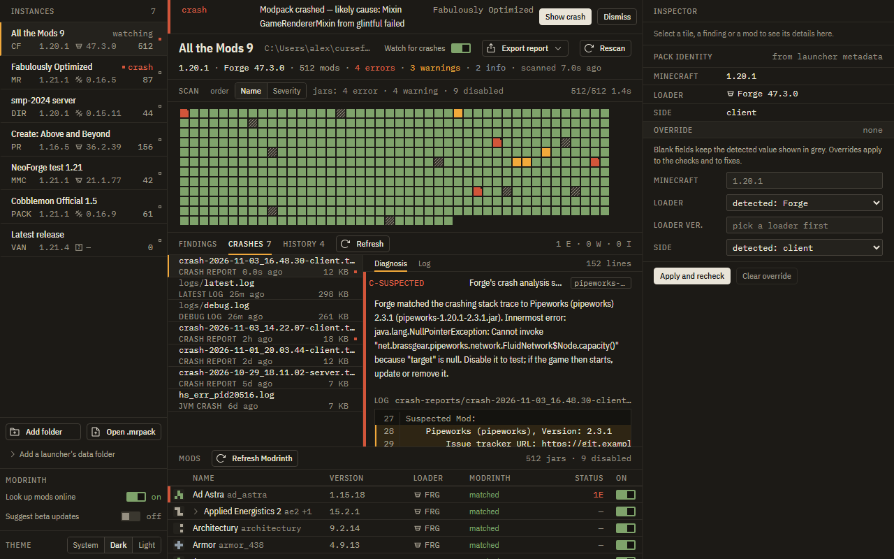
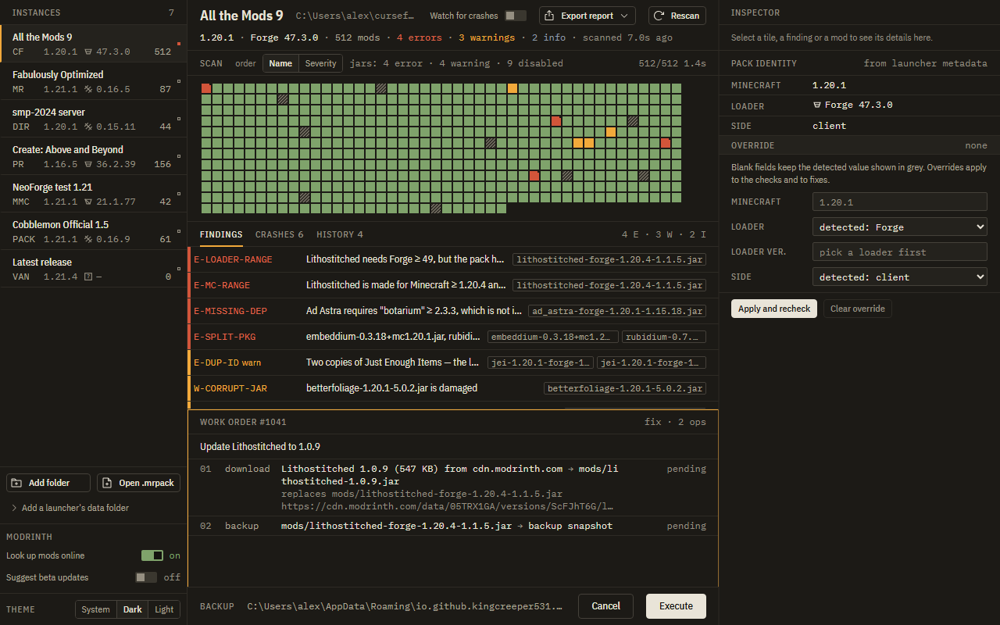
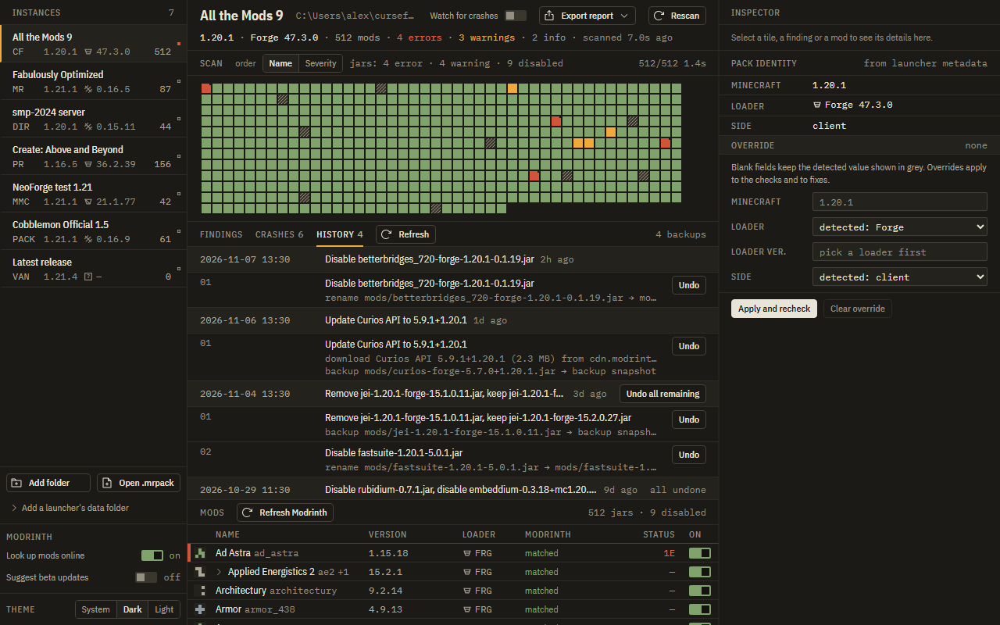

# Modpack Doctor

A desktop app for Windows, macOS and Linux that finds your Minecraft instances, works out why a
modpack crashes, names the mod or mods responsible, and fixes them in ways you can undo.

## Download

Get the installer for your system from the
[Releases](https://github.com/KingCreeper531/modpack-doctor/releases) page:

| System | File |
|---|---|
| Windows | `.msi` or the `.exe` setup |
| macOS (Apple silicon and Intel) | `.dmg` |
| Linux | `.AppImage` or `.deb` |

The installers aren't code-signed yet, so your system warns the first time you open the app:

- **Windows:** click "More info", then "Run anyway".
- **macOS 15 and newer:** open the app once and dismiss the warning, then go to System Settings →
  Privacy & Security and click "Open Anyway" next to Modpack Doctor. On older macOS, right-click
  the app and choose Open.

## What it does

**Finds your instances** from the Modrinth App, Prism Launcher, MultiMC, CurseForge and the vanilla
launcher automatically. You can also add any folder yourself, or open a `.mrpack` file (with "Open
.mrpack" or by dropping it on the window) to check a pack before you install it.

**Checks every mod** without starting the game, and tells you when a mod:

- is made for a different loader (Forge, NeoForge, Fabric or Quilt) than the pack uses;
- doesn't support the pack's Minecraft or loader version;
- needs another mod that's missing, or the wrong version of it;
- is installed twice, or clashes with another mod;
- is client-only but sits in a server;
- needs a newer Java than the pack uses;
- is damaged and can't be read.

**Explains crashes.** It reads each instance's crash reports and logs and shows the lines that matter
and the mod behind them: mixin failures, missing dependencies, duplicate packages, wrong Java
version, out of memory and more. Turn on watch mode for an instance and it tells you why the game
crashed the moment it happens.

**Looks mods up on Modrinth** to show each mod's name and icon, and to find a newer version that
works with your pack. Mods that aren't on Modrinth still get every check.

**Fixes problems:** disable or re-enable a mod, remove a duplicate, update a mod to a compatible
version, or install a missing dependency.

You can also export a report (Markdown for Discord or GitHub, or JSON) to share when asking for
help. Your user folder is shown as `~` in it.

## Screenshots

| | |
|---|---|
|  |  |
| **Crash analysis:** the lines that matter and the mod behind them. | **Every fix is shown first:** nothing changes until you press Execute. |
|  | |
| **History:** undo any change, one at a time or all at once. | |

## Your files are safe

- **You see every change first.** Each fix is shown as a numbered list of exactly what will happen
  to which file. Nothing changes until you press Execute.
- **Everything can be undone** from the History tab.
- **Nothing is deleted.** Removed or replaced mods are moved into a backup, which is never cleaned
  up automatically.
- **Nothing changes while the game is running.** Close Minecraft first.
- **Downloads come only from Modrinth** and are checked against Modrinth's file hash before they're
  used.
- **`.mrpack` files are only read**, never changed or unpacked.

## Privacy

- No account, no telemetry, no analytics.
- The app talks to Modrinth to identify mods and find updates. Switch off "Look up mods online"
  (bottom of the instance list) to stop that. Every check and crash analysis still works offline.
- It contacts GitHub only when you click "Check for updates".

## Updates

The app checks for updates only when you ask: About → "Check for updates". You see the new
version and its notes first, and nothing is downloaded until you click Install. Every update is
verified against the app's signature before it installs.

## Keyboard

| Keys | Action |
|---|---|
| Ctrl+K / Cmd+K | command palette |
| J / K | next / previous finding |
| Enter | open or close the selected finding |
| Ctrl+R / Cmd+R | scan again |
| Esc | close |

Right-click mods and findings for more actions.

## Problems or ideas

Open an issue on the [Issues](https://github.com/KingCreeper531/modpack-doctor/issues) page.
Attaching an exported report helps.

## Disclaimer

Modpack Doctor is not affiliated with or endorsed by Modrinth, Mojang, Microsoft, Forge, NeoForge,
Fabric, or Quilt. Mod data comes from the Modrinth API.

## License

Copyright (C) 2026 KingCreeper531

Modpack Doctor is open source under the [GNU General Public License v3.0](LICENSE).

- You can use it, read the code, change it and share it.
- If you share it, or anything built from it, you have to release the full source code under the
  same license and keep the copyright notice. Nobody can turn it into a closed-source product.
